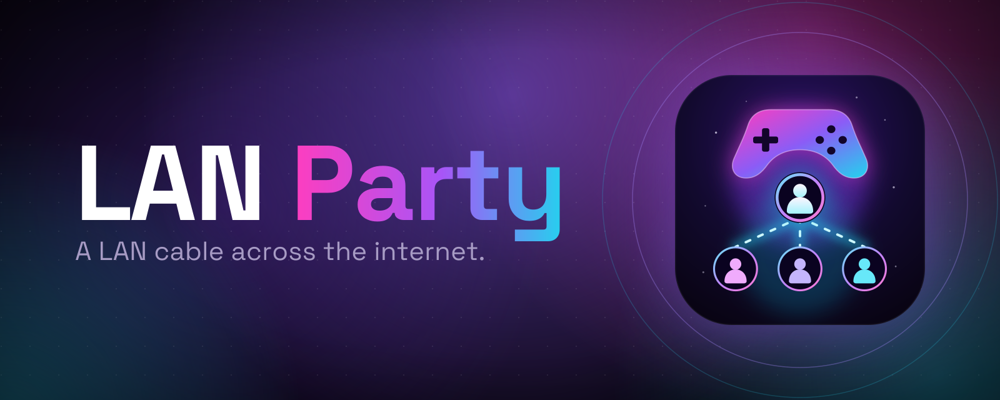
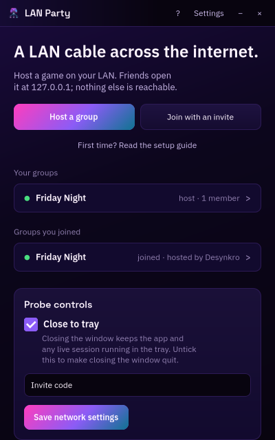
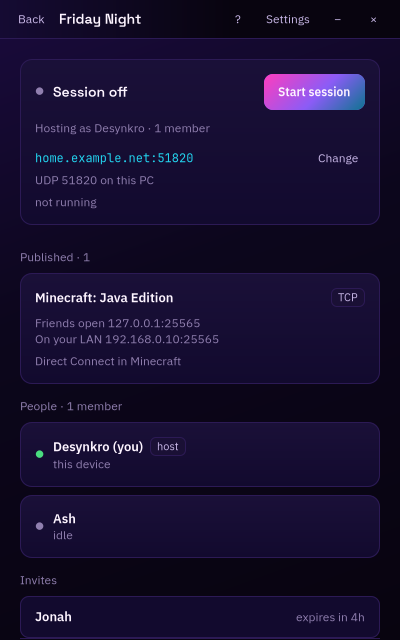

<p align="center">
  <picture>
    
  </picture>
</p>

<p align="center">
  <strong>A LAN cable across the internet.</strong><br>
  One port. Your friends. Nothing else.
</p>

<p align="center">
  <a href="LICENSE"></a>
  <a href="https://github.com/DeSynkro/lan-party/releases"></a>
  <a href="https://ko-fi.com/desynkro"></a>
</p>

<p align="center">
  Built by <a href="https://desynkro.com">DeSynkro</a> with assistance from <a href="https://opencode.ai">OpenCode</a>.
</p>

LAN Party is a small desktop app that gives your friends one local port onto a game server on your LAN. Make a group, run the game server, then add it to a group as a service, choose the port friends should see, and start a session. 

Your friend pastes a one-time invite, you approve their device once. Their game then connects to `127.0.0.1:<port>` as if the server were on their own machine.

If you cannot forward a port, run the optional self-hosted relay on a VPS or spare machine. It forwards encrypted packets and cannot read the game traffic. See [relay/README.md](relay/README.md).

If the host should live on a homelab or VPS instead of your desktop, 1.3 adds a host-only web UI. It runs the same engine without GTK or a tray; friends keep using the desktop app. See [docs/web-host.md](docs/web-host.md).

The traffic crosses one encrypted QUIC connection to your PC, where the app dials the real LAN target. There is no virtual network, no route, and no peer-to-peer path. Your router, your NAS and the rest of your LAN are never reachable from the friend's machine.

<p align="center">
  
  &nbsp;&nbsp;
  
</p>

## Why this exists

Most ways to play a LAN game over the internet put both machines on a virtual network. Which is fine, but it exposes far more than the one port you wanted to share, and it usually brings accounts, a daemon, or a Windows-only client.

LAN Party does one thing. It carries your selected game service from your LAN to a friend's loopback address over one encrypted connection. No virtual LAN, no routes, no accounts, no telemetry.

It is deliberately lightweight and to the point. If you need a whole virtual network, use Tailscale or ZeroTier. If you need one game port for a friend, this is for you :)

## Requirements

- **Linux on x86-64** with X11 or Wayland. The AppImage is built on Ubuntu 22.04 against a deliberately low baseline: **GTK 4.6**, **GLib 2.72** and **glibc 2.34** so it supports older LTS releases, not just current distros. Any distro shipping GTK 4.6, GLib 2.72 and glibc 2.34 or newer should work. Officially tested with **CachyOS** and **SteamOS** please provide me feedback on your personal experience.
- **Windows 10 or 11 on x86-64.** The portable zip includes the GTK4 runtime. No installer, admin rights or account is needed.
- **One UDP port forwarded** on the host's router, or a self-hosted relay when a forward is not possible. Friends do not need a forward.
- **A public address** that reaches the host: a hostname, a static IP, or a dynamic DNS name, or a relay for a host behind carrier-grade NAT.
- **Optional:** the 1.3 web host on a homelab or VPS needs Linux amd64/arm64 or Docker, and no desktop session.
- No keyring daemon, no account and no telemetry.

### For the AppImage

The AppImage uses the system GTK4 runtime. You need FUSE, or run it with `--appimage-extract-and-run`. On Ubuntu 24.04+ install `libfuse2t64`. On Arch install `fuse2`.

### For the Windows zip

Extract the zip and keep the folder together. Run `lan-party.cmd`. The first launch may show a Windows Defender SmartScreen warning because this build is not signed. Choose **More info** and **Run anyway** only if you trust the download. Allow LAN Party on private networks when Windows Firewall asks. The app keeps its settings in `%AppData%\lan-party`, and its groups, keys and log in `%LocalAppData%\lan-party`.

# Build requirements

Building needs GTK4 and GLib 2.72+ development headers, a C compiler and `pkg-config`. The pinned Go toolchain is downloaded into `.tools` on the first build. Nothing is installed system-wide.

**On Debian/Ubuntu:**

```sh
sudo apt install build-essential pkg-config libgtk-4-dev libglib2.0-dev \
  libgirepository1.0-dev gobject-introspection libwayland-dev \
  libxkbcommon-dev wayland-protocols xorg-dev
```

**On Fedora:**

```sh
sudo dnf install gcc pkgconf-pkg-config gtk4-devel glib2-devel \
  gobject-introspection-devel
```

**On Arch:**

```sh
sudo pacman -S --needed base-devel gtk4 glib2 libgirepository
```

Windows builds use MSYS2 UCRT64. See [docs/development.md](docs/development.md#windows).

## Install

Download the artifact for your platform and `SHA256SUMS` from [Releases](https://github.com/DeSynkro/lan-party/releases).

### Linux AppImage

1. Verify the download. `--ignore-missing` lets Linux users verify only the files they downloaded:

   ```sh
   sha256sum -c --ignore-missing SHA256SUMS
   ```

2. Make it executable and run it:

   ```sh
   chmod +x lan-party_1.3.0_linux_amd64.AppImage
   ./lan-party_1.3.0_linux_amd64.AppImage
   ```

The AppImage uses the system GTK4 runtime and needs FUSE. On Ubuntu 24.04+ install `libfuse2t64`. On Arch install `fuse2`. Without FUSE, run it with `--appimage-extract-and-run`.

The app keeps its data in `~/.config/lan-party` and `~/.local/share/lan-party`. To update, replace the AppImage. To uninstall, turn off **Start on login**, delete the AppImage and remove those two folders.

### Windows portable zip

1. Download `lan-party_1.3.0_windows_amd64.zip` and `SHA256SUMS`.
2. Verify the zip in PowerShell. Compare the hash to the Windows zip line in `SHA256SUMS`:

   ```powershell
   Get-FileHash .\lan-party_1.3.0_windows_amd64.zip -Algorithm SHA256
   ```

3. Extract the zip and keep the folder together. Run `lan-party.cmd`.

Windows may show a SmartScreen warning because this build is not code-signed. Choose **More info** and **Run anyway** only if you trust the download. Windows Defender can occasionally false-positive an unsigned new release. See [Sending a log](#sending-a-log) and the release notes if that happens.

Allow LAN Party on **private networks** when Windows Firewall asks. The app keeps settings in `%AppData%\lan-party`, and groups, keys and the log in `%LocalAppData%\lan-party`. To update, replace the folder. To uninstall, delete the folder and turn off **Start on login** in Settings first.

There is no Windows installer in 1.3. The console debug build is a separate manual CI artifact, not part of the release zip.

### Web host

Download `lan-party-web_1.3.0_linux_amd64.zip` or
`lan-party-web_1.3.0_linux_arm64.zip`, extract it, and run `native/run.sh`. For
Docker, use the `docker/` folder in the same zip or the Compose files in
`server/docker`. See [docs/web-host.md](docs/web-host.md) for the router
forward, firewall and first-run steps.

## Build and run from source

```sh
make run       # build and open the app with project-local config
make test      # unit and end-to-end tests
make build     # binary in bin/
make appimage  # Linux AppImage in dist/
```

`make run` keeps development config, data and caches inside the project. `make appimage` writes `dist/lan-party_<version>_linux_amd64.AppImage`.

## Features

- **One port, one friend:** each service publishes a loopback address such as `127.0.0.1:25565`.
- **Windows and Linux:** a portable Windows zip with the GTK runtime included, and a Linux AppImage.
- **TCP and UDP:** forward either or both, with an optional port remap.
- **Per-group connection:** a host group can use its own public address and UDP port. Blank fields use the Settings defaults.
- **One-time invites:** hashed at rest, 1-hour expiry, and host approval for every new device or changed device key. Changing a group's advertised endpoint cancels its open invites.
- **Automatic reconnect:** a dropped friend connection retries on a 30-minute backoff window. The setting can turn it off.
- **Live presence:** see who is connected, their RTT, and revoke a device immediately.
- **Live service updates:** add, edit or remove a service while friends are connected. New services default to `127.0.0.1` and accept `localhost`.
- **Join preview:** the joining friend sees the name the host assigned and a read-only detected device name. Host rows show each member's device tag.
- **Readable logs:** a rotating log in the data directory, with the path shown in Settings → About.
- **Saved groups:** keep your regular groups and friends, and reconnect after a host restart.
- **Presets:** Minecraft Java and Bedrock, Terraria, Valheim, Factorio, Palworld, rAthena Ragnarok Online, Stardew Valley, Project Zomboid, 7 Days to Die, Rust, Source engine, ARK, Don't Starve Together, Jellyfin and Plex.
- **Fixed 400×640 interface:** a small GTK4 window that stays out of the way.
- **Tray and autostart:** close to tray, start minimised, and start on login.
- **No virtual network:** the friend cannot reach the rest of your LAN.
- **No telemetry:** no accounts, no analytics, no cloud.

## How it works

<p align="center">
  <a href="docs/how-it-works.svg"></a>
</p>

1. **One port out.** The host publishes the group on a single UDP port, 51820 by default. The router forwards only that port to the host PC.
2. **A one-time invite.** The friend pastes an invite. The app connects over QUIC, pins the host's key and asks the host to approve the device.
3. **One approval.** The host approves the device once. From then on, its key is the membership.
4. **A loopback port on the friend's PC.** The friend's app opens `127.0.0.1:<port>` for each published service.
5. **The host dials the LAN.** Game traffic crosses the encrypted tunnel, and the host connects to the real server on the LAN.

The host is the only peer a friend connects to. Friends never see or connect to each other. The host sees the full member list. Nothing else on the host's LAN is reachable.

## Setup

### Host

1. Add the game server as a service: protocol, LAN IP, game port(s), and optionally, custom port(s) for your friends to use.
2. Forward one UDP port on the router to the host PC.
3. Set the public address in **Settings**, or enable **Use Relay** and enter the relay details.
4. Start the session and create an invite.
5. Approve the friend when they connect.

### Friend

1. Open the invite and join the group.
2. Wait for the host to approve the device.
3. Start the game and connect to the loopback address shown in the app, usually `127.0.0.1:<port>`

The in-app guide has the full walkthrough with your current ports and addresses filled in. See [docs/guide.md](docs/guide.md) for the longer version.

## What data is stored

| Path | Contents |
| --- | --- |
| `~/.config/lan-party/settings.json` | Public address, app port, startup preferences |
| `~/.local/share/lan-party/groups.json` | Groups, services, members, invite hashes |
| `~/.local/share/lan-party/keys/` | Long-lived private keys, relay passwords and relay reconnect tokens (`0600`) |
| `~/.config/autostart/lan-party.desktop` | Autostart entry when enabled |
| `~/.local/share/lan-party/lan-party.log` | Application log. `%LocalAppData%\lan-party\lan-party.log` on Windows |

The 1.3 web host keeps its own directory beside `compose.yaml` or
`run.sh`: `data/settings.json`, `data/groups.json`, `data/web.json`,
`data/keys/` and `data/lan-party.log`. The desktop app's directories are not
touched.

On Windows, settings live under `%AppData%\lan-party`. Groups, keys and the log live under `%LocalAppData%\lan-party`. Start on login uses the per-user `HKCU\Software\Microsoft\Windows\CurrentVersion\Run` key, not Task Scheduler or an admin service.

The JSON files and key files are owner-only (`0600`). The data and key directories are `0700`. Invites contain no private keys. No telemetry leaves your machine. The only traffic is the encrypted tunnel between the host and an approved friend, plus encrypted packets to the relay when relay mode is enabled.

## Tech stack

| Part | Technology |
| --- | --- |
| Language | Go |
| UI | GTK4 through gotk4 |
| Transport | QUIC through quic-go |
| Tray | fyne.io/systray |
| Packaging | AppImage, portable Windows zip and GitHub Actions |

## Troubleshooting

### The AppImage does not start

If it reports a FUSE error, install FUSE or run it with `--appimage-extract-and-run`.

If it reports a missing GTK library, install GTK4 (for example `libgtk-4-1` on Debian/Ubuntu). The AppImage uses the system GTK runtime.

### Windows shows a SmartScreen or Defender warning

The 1.3 Windows build is not code-signed. SmartScreen may ask you to confirm the app. Use **More info** and **Run anyway** only if the SHA-256 matches the release's `SHA256SUMS`.

Windows Defender can occasionally false-positive an unsigned new build. Do not disable Defender. Submit the zip through Microsoft's [false-positive form](https://www.microsoft.com/en-us/wdsi/filesubmission), and send the log so the cause can be checked. Code signing is still planned.

### Sending a log

LAN Party writes a log next to its data:

- Linux: `~/.local/share/lan-party/lan-party.log`
- Windows: `%LocalAppData%\lan-party\lan-party.log`

The log rotates at 5 MB and keeps one previous file. It does not contain invite
codes, tokens or private keys. Send the log when reporting a startup or session
problem.

### The friend cannot connect

Check the router's UDP forward, the public address and the host's firewall. The host must allow inbound UDP on the app port (51820 by default). On Windows, allow LAN Party on private networks in the Windows Firewall prompt. Friends do not need a forward.
Make sure you've clicked "Start Session".

### The invite says it is expired

Invites work once and expire after 1 hour. Create a new one.

### The friend sees only the host

That is intentional. Friends are not connected to each other. The host sees the full member list, clients do not.

### Closing the window quits the app

On Linux the tray needs a StatusNotifier host. On GNOME, install the AppIndicator extension to get a tray icon. On Windows the tray lives in the notification area. If you do not see it, check the overflow menu. Without a working tray, closing the window quits and Settings explains this.

### Start on login stopped working after moving the app

Turn **Start on login** off and on again so the autostart entry points at the new AppImage or Windows folder.

## Docs

- [docs/guide.md](docs/guide.md) — setup and troubleshooting
- [docs/for-friends.md](docs/for-friends.md) — a plain-language explanation to send to friends
- [docs/architecture.md](docs/architecture.md) — how a connection moves
- [docs/security.md](docs/security.md) — identities, invites, threat model
- [docs/development.md](docs/development.md) — layout, build and release
- [SECURITY.md](SECURITY.md) — how to report a vulnerability
- [CHANGELOG.md](CHANGELOG.md) — release history
- [THIRD_PARTY_NOTICES.md](THIRD_PARTY_NOTICES.md) — dependency licenses

## Roadmap

<p align="center">
  <a href="docs/roadmap.svg"></a>
</p>

The short version: **1.0** is the Linux release. **1.1** adds the Windows portable build, per-group connection overrides, one-hour invites, automatic reconnect and service editing. **1.2** adds the self-hosted relay, relay reconnect tokens, inactive-friend cleanup and a no-root native relay console. **1.3** adds the host-only web UI for a homelab or VPS, with Docker and native packaging. **2.0** is the long shelf for Flatpak, auto-update and the next big idea.

The full notes live in [features-to-be-added.md](features-to-be-added.md). Versions and scope are a direction, not a promise.

## Support

If this is useful to you, you can support me on [Ko-fi](https://ko-fi.com/desynkro). More of my work is at [desynkro.com](https://desynkro.com).

## License

GPLv3. See [LICENSE](LICENSE) and [NOTICE](NOTICE). The AppImage and Windows zip ship the license, font licenses and third-party notices.

## Credits

- Built by [DeSynkro](https://desynkro.com)
- Assisted by [OpenCode](https://opencode.ai)
- [GTK](https://www.gtk.org/) and the [gotk4](https://github.com/diamondburned/gotk4) project
- [quic-go](https://github.com/quic-go/quic-go) for the encrypted transport
- [fyne.io/systray](https://github.com/fyne-io/systray) for the tray
- Thank you to everyone who supported me and helped me test it 😄️

<p align="center">
  <a href="https://desynkro.com" target="_blank">
    
  </a>
</p>
