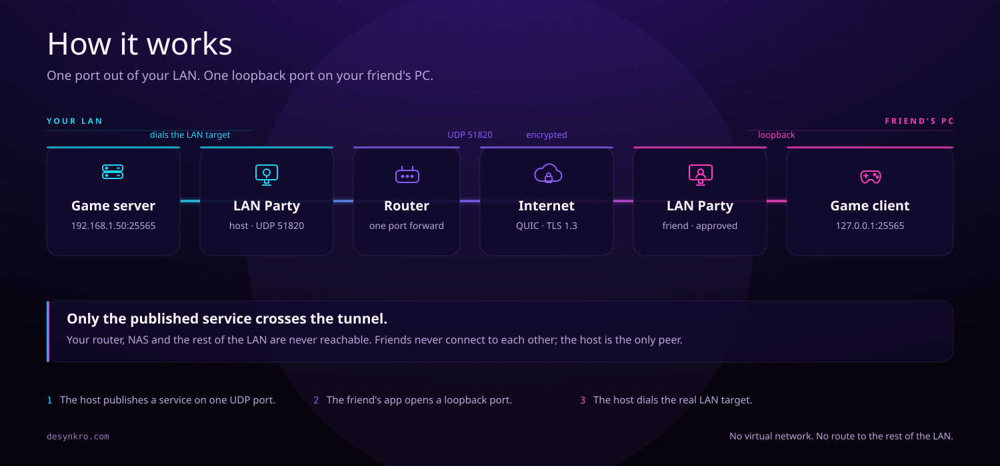
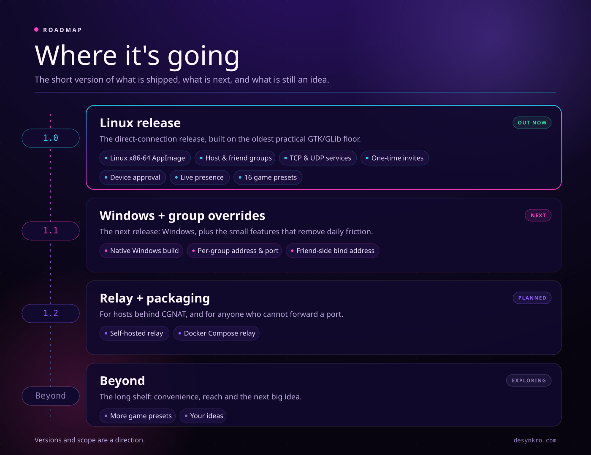

<p align="center">
  <picture>
    
  </picture>
</p>

<p align="center">
  <strong>A LAN cable across the internet.</strong><br>
  One port. Your friends. Nothing else.
</p>

<p align="center">
  <a href="LICENSE"></a>
  <a href="https://github.com/DeSynkro/lan-party/releases"></a>
  <a href="https://ko-fi.com/desynkro"></a>
</p>

<p align="center">
  Built by <a href="https://desynkro.com">DeSynkro</a> with assistance from <a href="https://opencode.ai">OpenCode</a>.
</p>

LAN Party is a small desktop app that gives your friends one local port onto a game server on your LAN. Make a group, run the game server, then add it to a group as a service, choose the port friends should see, and start a session. 

Your friend pastes a one-time invite, you approve their device once. Their game then connects to `127.0.0.1:<port>` as if the server were on their own machine.

The traffic crosses one encrypted QUIC connection to your PC, where the app dials the real LAN target. There is no virtual network, no route, and no peer-to-peer path. Your router, your NAS and the rest of your LAN are never reachable from the friend's machine.

<p align="center">
  
  &nbsp;&nbsp;
  
</p>

## Why this exists

Most ways to play a LAN game over the internet put both machines on a virtual network. Which is fine, but it exposes far more than the one port you wanted to share, and it usually brings accounts, a daemon, or a Windows-only client.

LAN Party does one thing. it carries your selected game service from your LAN to a friend's loopback address over one encrypted connection. No virtual LAN, no routes, no accounts, no telemetry.

It is deliberately lightweight and to the point. If you need a whole virtual network, use Tailscale or ZeroTier. If you need one game port for a friend, this is for you :)

## Requirements

- **Linux on x86-64** with X11 or Wayland. The AppImage is built on Ubuntu 22.04 against a deliberately low baseline: **GTK 4.6**, **GLib 2.72** and **glibc 2.34** so it supports older LTS releases, not just current distros. Any distro shipping GTK 4.6, GLib 2.72 and glibc 2.34 or newer should work. Officially tested with **CachyOS** and **SteamOS** please provide me feedback on your personal experience.
- **One UDP port forwarded** on the host's router. Friends do not need a forward.
- **A public address** that reaches the host: a hostname, a static IP, or a dynamic DNS name.
- No keyring daemon, no account and no telemetry.

### For the AppImage

The AppImage uses the system GTK4 runtime. You need FUSE, or run it with `--appimage-extract-and-run`. On Ubuntu 24.04+ install `libfuse2t64`; on Arch install `fuse2`.

# Build requirements

Building needs GTK4 and GLib 2.72+ development headers, a C compiler and `pkg-config`. The pinned Go toolchain is downloaded into `.tools` on the first build; nothing is installed system-wide.

**On Debian/Ubuntu:**

```sh
sudo apt install build-essential pkg-config libgtk-4-dev libglib2.0-dev \
  libgirepository1.0-dev gobject-introspection libwayland-dev \
  libxkbcommon-dev wayland-protocols xorg-dev
```

**On Fedora:**

```sh
sudo dnf install gcc pkgconf-pkg-config gtk4-devel glib2-devel \
  gobject-introspection-devel
```

**On Arch:**

```sh
sudo pacman -S --needed base-devel gtk4 glib2 libgirepository
```

## Install

Download the AppImage and `SHA256SUMS` from [Releases](https://github.com/DeSynkro/lan-party/releases), then:

```sh
chmod +x lan-party_1.0.0_linux_amd64.AppImage
./lan-party_1.0.0_linux_amd64.AppImage
```

Verify the download first:

```sh
sha256sum -c SHA256SUMS
```

The AppImage runs as a single file. To add it to your application menu, use AppImageLauncher or create a desktop entry for it.

The app keeps its data in `~/.config/lan-party` and `~/.local/share/lan-party`. To update, replace the AppImage. To uninstall, turn off **Start on login**, delete the AppImage and remove those two folders.

## Build and run from source

```sh
make run       # build and open the app with project-local config
make test      # unit and end-to-end tests
make build     # binary in bin/
make appimage  # Linux AppImage in dist/
```

`make run` keeps development config, data and caches inside the project. `make appimage` writes `dist/lan-party_<version>_linux_amd64.AppImage`.

## Features

- **One port, one friend:** each service publishes a loopback address such as `127.0.0.1:25565`.
- **TCP and UDP:** forward either or both, with an optional port remap.
- **Per-group connection:** a host group can use its own public address and UDP port; blank fields use the Settings defaults.
- **One-time invites:** hashed at rest, 1-hour expiry, and host approval for every new device or changed device key.
- **Live presence:** see who is connected, their RTT, and revoke a device immediately.
- **Live service updates:** add, remove or change a service while friends are connected.
- **Saved groups:** keep your regular groups and friends, and reconnect after a host restart.
- **Presets:** Minecraft Java and Bedrock, Terraria, Valheim, Factorio, Palworld, rAthena Ragnarok Online, Stardew Valley, Project Zomboid, 7 Days to Die, Rust, Source engine, ARK, Don't Starve Together, Jellyfin and Plex.
- **Fixed 400×640 interface:** a small GTK4 window that stays out of the way.
- **Tray and autostart:** close to tray, start minimised, and start on login.
- **No virtual network:** the friend cannot reach the rest of your LAN.
- **No telemetry:** no accounts, no analytics, no cloud.

## How it works

<p align="center">
  <a href="docs/how-it-works.svg"></a>
</p>

1. **One port out.** The host publishes the group on a single UDP port, 51820 by default. The router forwards only that port to the host PC.
2. **A one-time invite.** The friend pastes an invite. The app connects over QUIC, pins the host's key and asks the host to approve the device.
3. **One approval.** The host approves the device once. From then on, its key is the membership.
4. **A loopback port on the friend's PC.** The friend's app opens `127.0.0.1:<port>` for each published service.
5. **The host dials the LAN.** Game traffic crosses the encrypted tunnel, and the host connects to the real server on the LAN.

The host is the only peer a friend connects to. Friends never see or connect to each other; the host sees the full member list. Nothing else on the host's LAN is reachable.

## Setup

### Host

1. Add the game server as a service: protocol, LAN IP, game port(s), and optionally, custom port(s) for your friends to use.
2. Forward one UDP port on the router to the host PC.
3. Set the public address in **Settings**.
4. Start the session and create an invite.
5. Approve the friend when they connect.

### Friend

1. Open the invite and join the group.
2. Wait for the host to approve the device.
3. Start the game and connect to the loopback address shown in the app, usually `127.0.0.1:<port>`

The in-app guide has the full walkthrough with your current ports and addresses filled in. See [docs/guide.md](docs/guide.md) for the longer version.

## What data is stored

| Path | Contents |
| --- | --- |
| `~/.config/lan-party/settings.json` | Public address, app port, startup preferences |
| `~/.local/share/lan-party/groups.json` | Groups, services, members, invite hashes |
| `~/.local/share/lan-party/keys/` | Long-lived private keys (`0600`) |
| `~/.config/autostart/lan-party.desktop` | Autostart entry when enabled |

The JSON files and key files are owner-only (`0600`); the data and key directories are `0700`. Invites contain no private keys. No traffic or telemetry leaves your machine except the encrypted tunnel between the host and an approved friend.

## Tech stack

| Part | Technology |
| --- | --- |
| Language | Go |
| UI | GTK4 through gotk4 |
| Transport | QUIC through quic-go |
| Tray | fyne.io/systray |
| Packaging | AppImage and GitHub Actions |

## Troubleshooting

### The AppImage does not start

If it reports a FUSE error, install FUSE or run it with `--appimage-extract-and-run`.

If it reports a missing GTK library, install GTK4 (for example `libgtk-4-1` on Debian/Ubuntu). The AppImage uses the system GTK runtime.

### The friend cannot connect

Check the router's UDP forward, the public address and the host's firewall. The host must allow inbound UDP on the app port (51820 by default). Friends do not need a forward.
Make sure you've clicked "Start Session".

### The invite says it is expired

Invites work once and expire after 1 hour. Create a new one.

### The friend sees only the host

That is intentional. Friends are not connected to each other. The host sees the full member list, clients do not.

### Closing the window quits the app

The tray needs a StatusNotifier host. On GNOME, install the AppIndicator extension to get a tray icon. Without it, closing the window quits and Settings explains this.

### Start on login stopped working after moving the AppImage

Turn **Start on login** off and on again so the autostart entry points at the new location.

## Docs

- [docs/guide.md](docs/guide.md) — setup and troubleshooting
- [docs/for-friends.md](docs/for-friends.md) — a plain-language explanation to send to friends
- [docs/architecture.md](docs/architecture.md) — how a connection moves
- [docs/security.md](docs/security.md) — identities, invites, threat model
- [docs/development.md](docs/development.md) — layout, build and release
- [SECURITY.md](SECURITY.md) — how to report a vulnerability
- [CHANGELOG.md](CHANGELOG.md) — release history
- [THIRD_PARTY_NOTICES.md](THIRD_PARTY_NOTICES.md) — dependency licenses

## Roadmap

<p align="center">
  <a href="docs/roadmap.svg"></a>
</p>

The short version: **1.0** is the Linux release. **1.1** brings Windows and the smaller quality-of-life features. **1.2** adds the self-hosted relay. **2.0** is the long shelf for Flatpak, auto-update and the next big idea.

The full notes live in [features-to-be-added.md](features-to-be-added.md). Versions and scope are a direction, not a promise.

## Support

If this is useful to you, you can support me on [Ko-fi](https://ko-fi.com/desynkro). More of my work is at [desynkro.com](https://desynkro.com).

## License

GPLv3. See [LICENSE](LICENSE) and [NOTICE](NOTICE). The AppImage ships the license, font licenses and third-party notices under `usr/share/licenses/lan-party/`.

## Credits

- Built by [DeSynkro](https://desynkro.com)
- Assisted by [OpenCode](https://opencode.ai)
- [GTK](https://www.gtk.org/) and the [gotk4](https://github.com/diamondburned/gotk4) project
- [quic-go](https://github.com/quic-go/quic-go) for the encrypted transport
- [fyne.io/systray](https://github.com/fyne-io/systray) for the tray
- Thank you to everyone who supported me and helped me test it 😄️

<p align="center">
  <a href="https://desynkro.com" target="_blank">
    
  </a>
</p>
