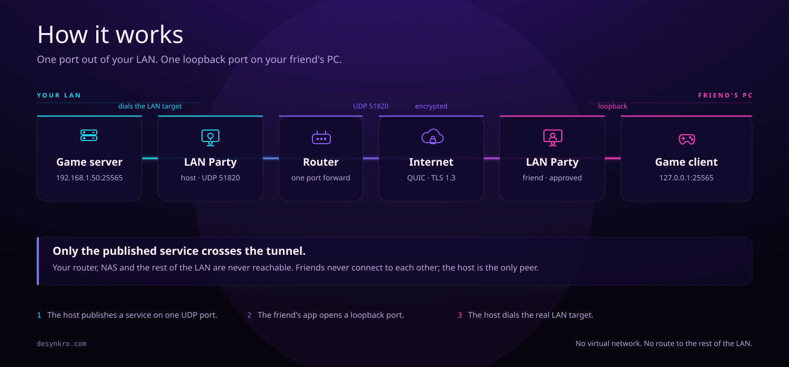

# LAN Party, explained simply

LAN Party lets me share **one game** from my PC with you over the internet.

It does not put you on my home network. It makes a private, encrypted path for
that one game.

## What you need to do

1. Install LAN Party.
2. I send you an invite code.
3. Paste the code into LAN Party and wait for me to approve your device.
4. Open the game.
5. In the game, connect to the address LAN Party shows you. It usually looks
   like `127.0.0.1:25565`.

The `127.0.0.1` address is not my home address. It is an address made on your
own PC so the game behaves as if the server is right next to you.

## What you do not need

- No port forwarding.
- No VPN setup.
- No account.
- No changes to your router.

## What I do

- I run the game server on my PC.
- I publish only that game's port in LAN Party.
- I keep LAN Party open while we play.
- I approve your device the first time.
- I can remove you at any time.

## What stays private

Only the game port I publish is reachable. You cannot see my router, my other
devices, my files, or another friend's PC. The connection is encrypted.

If I close LAN Party or end the session, the game disconnects.

## If it does not connect

- Make sure I am online and the session is running.
- Make sure you pasted the latest invite.
- Open the game after LAN Party shows its address.
- Use the address LAN Party shows, not my home LAN address.
- If the app says the port is in use, it will show the address it actually
  used. Use that one.

## A short message you can send

> Hey, install LAN Party. I'll send you an invite. Paste it in, I'll approve
> your device, then open the game and connect to the address it shows — usually
> `127.0.0.1:25565`. You don't need to change your router or set up a VPN.
