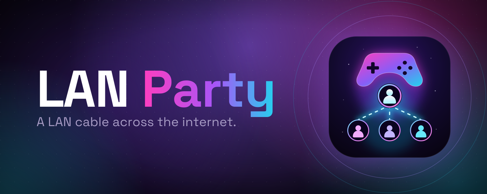

<p align="center">
  
</p>

<p align="center">
  <strong>A LAN cable across the internet.</strong><br> One port. Your friends. Nothing else.
</p>

LAN Party is a small desktop app that gives your friends one local port onto a game server on your LAN. Make a group, run the game server, then add it to a group as a service, choose the port friends should see, and start a session.

Your friend pastes a one-time invite, you approve their device once. Their game then connects to `127.0.0.1:<port>` as if the server were on their own machine.

The traffic crosses one encrypted QUIC connection to your PC, where the app dials the real LAN target. There is no virtual network, no route, and no peer-to-peer path. Your router, your NAS and the rest of your LAN are never reachable from the friend's machine.

New here? The [setup guide](https://github.com/DeSynkro/lan-party/blob/main/docs/guide.md) walks through the router rule and the first invite.

## What's in 1.1

- **Windows 10/11 x86-64 portable build** with the GTK4 runtime included, a GUI executable, tray, start on login and start minimised.
- **Per-group connection:** a host group can use its own public address and UDP app port, with blank fields falling back to Settings.
- **One-hour invites**, still single use and hashed at rest.
- **Endpoint-safe invites:** changing a group's advertised endpoint cancels its open invites. The warning appears only when an invite is actually open.
- **Invite guard:** creating an invite starts the host session first when it is off. A session for another group blocks the invite instead of being ended silently.
- **Automatic reconnect:** a dropped friend connection retries for up to 30 minutes, using 1s, 2s, 5s, 10s, 15s and 30s backoff before settling at 30s and then 60s. Manual Reconnect resets the timer. The setting can turn it off.
- **Service editing:** published services can be changed in place, with live updates. New services default to `127.0.0.1`, accept `localhost`, and explain when to use a LAN IP.
- **Join preview:** the friend sees the host-assigned name and a read-only detected device name. Host member rows show each member's device tag.
- **Rotating logs:** a support log in the data directory, with the path shown in Settings → About.
- Host and friend groups, TCP and/or UDP services, optional friend-side port remaps, live presence, revocation and 16 game presets from 1.0.

## Install

Download the artifact for your platform and `SHA256SUMS` from this release.

### Linux AppImage

1. Verify the download. `--ignore-missing` lets Linux users verify only the files they downloaded:

   ```sh
   sha256sum -c --ignore-missing SHA256SUMS
   ```

2. Make it executable and run it:

   ```sh
   chmod +x lan-party_1.1.0_linux_amd64.AppImage
   ./lan-party_1.1.0_linux_amd64.AppImage
   ```

The AppImage uses the system GTK4 runtime and needs FUSE. On Ubuntu 24.04+ install `libfuse2t64`. On Arch install `fuse2`. Without FUSE, run:

```sh
./lan-party_1.1.0_linux_amd64.AppImage --appimage-extract-and-run
```

### Windows portable zip

1. Download `lan-party_1.1.0_windows_amd64.zip` and `SHA256SUMS`.
2. Verify the zip. Compare the hash to the Windows line in `SHA256SUMS`:

   ```powershell
   Get-FileHash .\lan-party_1.1.0_windows_amd64.zip -Algorithm SHA256
   ```

3. Extract the zip and keep the folder together. Run `lan-party.cmd`.

Windows may show a SmartScreen warning because this build is not code-signed. Choose **More info** and **Run anyway** only if you trust the download and the SHA-256 matches. Allow LAN Party on **private networks** when Windows Firewall asks.

The app keeps settings in `%AppData%\lan-party`, and groups, keys and the log in `%LocalAppData%\lan-party`. There is no installer. Replace the folder to update, and turn off **Start on login** before deleting it.

## Requirements

- Linux on x86-64 with X11 or Wayland. GTK 4.6, GLib 2.72 and glibc 2.34 or newer.
- Windows 10 or 11 on x86-64. No installer, admin rights or account.
- One UDP port forwarded on the host's router. Friends do not forward anything.
- A public address that reaches the host: a hostname, static IP or dynamic DNS name.

The Linux floor covers Ubuntu 22.04+, Debian 12+, Linux Mint 21+, Pop!_OS 22.04+, Fedora 36+, and Arch-based systems including SteamOS 3 in Desktop Mode.

## Known limitations

- **Windows is unsigned.** SmartScreen and Defender may warn about a new unsigned executable. Code signing is planned after 1.1. If Defender flags the zip, submit it through Microsoft's [false-positive form](https://www.microsoft.com/en-us/wdsi/filesubmission) and send the log.
- **One live session at a time.** You can host one group or join one friend group. Per-group connection overrides do not allow two groups to be live simultaneously.
- **The host needs a forwarded port and a public address.** A self-hosted relay for CGNAT hosts is planned for 1.2.
- **The Windows build is portable.** There is no installer or Start Menu entry. The folder contains the app and its GTK runtime.
- **The AppImage uses the system GTK4 runtime.** GTK is not bundled.
- **No auto-update.** Replace the AppImage or Windows folder to update.
- **Friends see the host and themselves, not other friends.** That is intentional. The host is the only peer in the tunnel.
- **The old WireGuard-era groups file and keyring keys are not imported.** Move the old data folder aside and create those groups again.

## Verification and source

- `SHA256SUMS` is attached to this release.
- Source for this release: https://github.com/DeSynkro/lan-party/tree/v1.1.0
- The AppImage and Windows zip include the GPLv3 license, copyright notice, bundled font licenses and third-party notices.
- The portable Windows zip ships one executable, `lan-party.exe`. The console debug build is a separate manual CI artifact, not part of this release.

## Feedback

Found a bug or have an idea? [Open an issue](https://github.com/DeSynkro/lan-party/issues).
For security problems, please follow [SECURITY.md](https://github.com/DeSynkro/lan-party/blob/main/SECURITY.md) and report them privately.

## Thanks

Thanks to everyone who tested the Windows build, the Linux AppImage, the Steam Deck, and the friend who tested from another state. The Windows tray and debug workflow feedback made this release better.

## License

GPLv3. See [LICENSE](https://github.com/DeSynkro/lan-party/blob/main/LICENSE).
