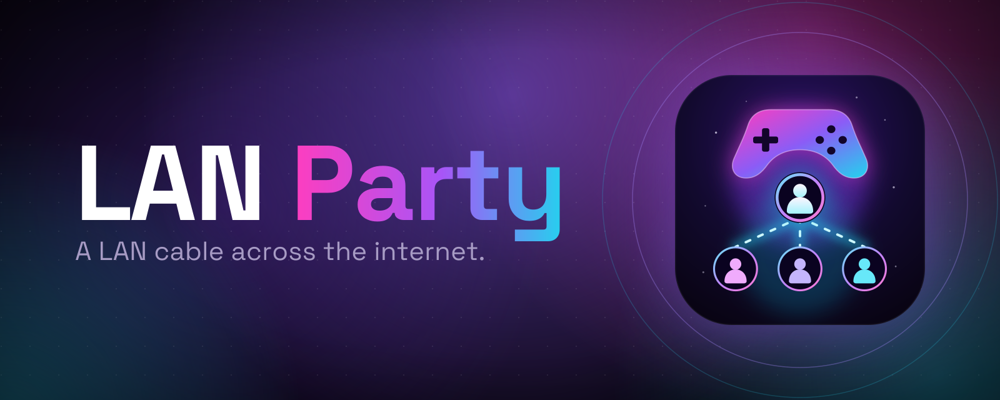

<p align="center">
  
</p>

<p align="center">
  <strong>A LAN cable across the internet.</strong><br> One port, or your own relay. Your friends. Nothing else.
</p>

LAN Party is a small desktop app that gives your friends one local port onto a game server on your LAN. Make a group, run the game server, then add it to a group as a service, choose the port friends should see, and start a session.

Your friend pastes a one-time invite, you approve their device once. Their game then connects to `127.0.0.1:<port>` as if the server were on their own machine.

The traffic crosses one encrypted QUIC connection to your PC, where the app dials the real LAN target. There is no virtual network, no route, and no peer-to-peer path. Your router, your NAS and the rest of your LAN are never reachable from the friend's machine.

New here? The [setup guide](https://github.com/DeSynkro/lan-party/blob/main/docs/guide.md) walks through the router rule and the first invite.

## What's in 1.2

- **Self-hosted relay:** a LAN Party relay you run on a VPS or spare Linux machine. Hosts behind CGNAT, a VPN, or a router they cannot forward can accept friends without an inbound port on the host PC.
- **Direct mode is still the default.** A relay is optional and explicit. Direct invites stay compatible with 1.1.
- **Opaque forwarding:** the relay forwards encrypted UDP packets. It never terminates or reads the host/friend QUIC/TLS connection. The host pin and end-to-end encryption are unchanged.
- **Pinned Relay ID:** the app verifies the relay public-key fingerprint. A changed key needs a deliberate Relay ID update.
- **Host-only relay password:** friends never receive the relay password. Each invite carries a short-lived first-join token.
- **Automatic relay reconnect:** after the first approved join, each device receives its own reconnect token over the encrypted connection. Friends reconnect with their saved token and device key when the host session restarts, their network drops, or the relay restarts. No new invite for every drop.
- **Host relay recovery:** an unexpected relay loss retries every 5 seconds for a minute, every 10 seconds for five minutes, then every 30 seconds for ten minutes before stopping for a manual Start.
- **Idle data-plane hardening:** while no host session exists, the relay does not bind UDP at all. Only the TLS control port remains, so the host can wake it.
- **Inactive friend cleanup:** for relay groups, the host can forget friends who have not connected for a chosen number of days. The window is configurable, defaults to 5 days on a new install, and can be blank for never. Live friends are never removed.
- **Reconnect reset:** remove a member or use **Reset reconnect** to revoke their relay reconnect token. The friend needs a new invite.
- **Docker and native relay packaging:** Docker Compose, a hardened systemd unit, and a no-root console runner (`native/run.sh`) that keeps its data in one user-owned directory and stops when the terminal closes.
- **Relay admin commands:** `showinfo`, `setpass`, `genpass`, `relayreset`, plus `set-public` for changing the advertised relay host/port without rotating the identity.
- Linux AppImage and Windows portable zip updates, including the relay settings UI, group Override Settings, and clearer long-error wrapping.

## Install

Download the artifact for your platform and `SHA256SUMS` from this release.

### Linux AppImage

1. Verify the download. `--ignore-missing` lets Linux users verify only the files they downloaded:

   ```sh
   sha256sum -c --ignore-missing SHA256SUMS
   ```

2. Make it executable and run it:

   ```sh
   chmod +x lan-party_1.2.0_linux_amd64.AppImage
   ./lan-party_1.2.0_linux_amd64.AppImage
   ```

The AppImage uses the system GTK4 runtime and needs FUSE. On Ubuntu 24.04+ install `libfuse2t64`. On Arch install `fuse2`. Without FUSE, run:

```sh
./lan-party_1.2.0_linux_amd64.AppImage --appimage-extract-and-run
```

### Windows portable zip

1. Download `lan-party_1.2.0_windows_amd64.zip` and `SHA256SUMS`.
2. Verify the zip. Compare the hash to the Windows line in `SHA256SUMS`:

   ```powershell
   Get-FileHash .\lan-party_1.2.0_windows_amd64.zip -Algorithm SHA256
   ```

3. Extract the zip and keep the folder together. Run `lan-party.cmd`.

Windows may show a SmartScreen warning because this build is not code-signed. Choose **More info** and **Run anyway** only if you trust the download and the SHA-256 matches. Allow LAN Party on **private networks** when Windows Firewall asks.

The app keeps settings in `%AppData%\lan-party`, and groups, keys and the log in `%LocalAppData%\lan-party`. There is no installer. Replace the folder to update, and turn off **Start on login** before deleting it.

## Requirements

- Linux on x86-64 with X11 or Wayland. GTK 4.6, GLib 2.72 and glibc 2.34 or newer.
- Windows 10 or 11 on x86-64. No installer, admin rights or account.
- Direct mode: one UDP port forwarded on the host's router and a public address that reaches the host.
- Relay mode: a reachable relay host and TCP + UDP on its one public port. The host PC needs no inbound port.

The Linux floor covers Ubuntu 22.04+, Debian 12+, Linux Mint 21+, Pop!_OS 22.04+, Fedora 36+, and Arch-based systems including SteamOS 3 in Desktop Mode.

## Relay quick start

The relay is optional and self-hosted. There is no project-operated public relay.

### Docker Compose

```sh
cd relay/docker
cp .env.example .env
# set LANPARTY_RELAY_PUBLIC_HOST and LANPARTY_RELAY_PORT
sudo docker compose up -d
sudo ./relayctl showinfo
```

From a source checkout use `sudo docker compose up --build -d`; the local Compose override builds the image from source.

### Native console, no root or systemd

```sh
unzip lan-party-relay_1.2.0_linux_amd64.zip
cd lan-party-relay_1.2.0_linux_amd64
./native/run.sh
```

The console runner keeps its data under `~/.local/share/lan-party-relay`, prompts for the public host and port, and provides a menu for info, host/port changes, passwords, Relay ID rotation and logs. Ctrl+C or the Stop item shuts it down. No system-wide files are installed.

### Native service

The optional systemd path is documented in `native/README.md`. It installs the binary, wrapper, unit and `/etc/lan-party-relay` data directory.

Then in the app: **Settings → Network defaults → Use Relay**, enter the relay host, port, Relay ID and password, and choose **Test relay**. The app pins the Relay ID. Do not post the Relay ID or password; friends join through invites.

## Known limitations

- **Windows is unsigned.** SmartScreen and Defender may warn about a new unsigned executable. If Defender flags the zip, submit it through Microsoft's [false-positive form](https://www.microsoft.com/en-us/wdsi/filesubmission) and send the log.
- **One live session at a time.** You can host one group or join one friend group.
- **The relay is private infrastructure.** It needs a public address and TCP + UDP on one port. A relay behind the same CGNAT or VPN that blocks inbound traffic cannot be reached. Put it on a VPS if the host PC must keep a VPN on.
- **Existing relay groups need one final invite** after upgrading, so each device can receive its reconnect token.
- **Inactivity cleanup only applies to relay groups.** New installs default to 5 days; existing settings files start blank/never until the host chooses a window. A forgotten friend needs a new invite.
- **Relay reconnect tokens are long-lived while the member exists.** If a device is lost, use **Reset reconnect** or remove the member.
- **The relay does not import or export a host profile.** Use `showinfo` / `show-info` and enter the values in the app.
- **The Windows build is portable.** There is no installer or Start Menu entry.
- **The AppImage uses the system GTK4 runtime.** GTK is not bundled.
- **No auto-update.** Replace the AppImage or Windows folder to update.
- **Friends see the host and themselves, not other friends.** That is intentional.
- **The old WireGuard-era groups file and keyring keys are not imported.** Move the old data folder aside and create those groups again.

## Verification and source

- `SHA256SUMS` is attached to this release.
- Source for this release: https://github.com/DeSynkro/lan-party/tree/v1.2.0
- The AppImage and Windows zip include the GPLv3 license, copyright notice, bundled font licenses and third-party notices.
- The relay zips include the Linux amd64 and arm64 binaries, Docker and native deployment assets, and the license notices.
- The relay container image is published as `ghcr.io/desynkro/lan-party-relay:1.2.0` and `:1.2`.

## Feedback

Found a bug or have an idea? [Open an issue](https://github.com/DeSynkro/lan-party/issues).
For security problems, please follow [SECURITY.md](https://github.com/DeSynkro/lan-party/blob/main/SECURITY.md) and report them privately.

## Thanks

Thanks to everyone who tested direct hosting, the Docker and native relays, the Windows build, and the reconnect paths. Special thanks to the friend who helped test relay reconnects across the internet.

## License

GPLv3. See [LICENSE](https://github.com/DeSynkro/lan-party/blob/main/LICENSE).
